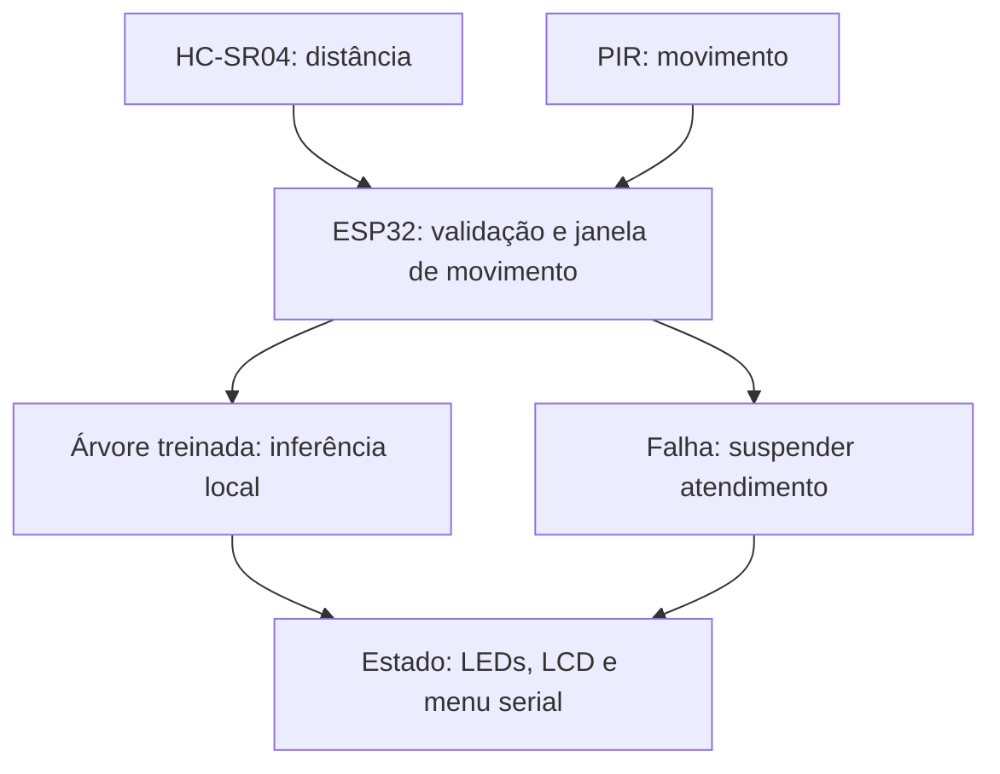

# Reencontro — Robô de Acolhimento CitizenTech

Project-Based Maker Lab · FIAP · Global Solution · Turma 4ESPV

| Integrante | RM |
|---|---|
| Irana Pereira | 98593 |
| Lucas Vinicius Candido | 98480 |
| Mariana Melo | 98121 |

## Problema e proposta

Pessoas que chegam a um ponto de apoio à busca de desaparecidos precisam de orientação inicial clara. Este protótipo de robô estacionário detecta aproximação e movimento, seleciona autonomamente um estado de atendimento e apresenta instruções em uma tela e no monitor serial.

Portal de apoio: https://reencontro-site.vercel.app/

**Escopo:** simulação no Wokwi. A IA é uma árvore de decisão pequena, treinada em Python e executada localmente no ESP32. Não há LLM, reconhecimento facial, identificação de pessoas ou consulta à base do portal. O menu contém orientações fixas. Abrir o portal é uma ação manual do usuário.

## Evolução documentada nesta entrega

O grupo não possuía robô anterior. As versões V1 e V2 foram concebidas nesta mesma entrega; não representam um trabalho realizado em semestre anterior. Como o enunciado menciona evolução de robô anterior, o enquadramento desta baseline deve ser validado com o professor.

| Versão | Sensores | Decisão | Demonstração |
|---|---|---|---|
| V1, baseline desta entrega | HC-SR04 | Regra fixa de proximidade | Alterar `VERSAO_EVOLUIDA` para `false` e executar |
| V2, evolução proposta | HC-SR04 + PIR adicional | Classificador treinado com fusão sensorial | Manter `VERSAO_EVOLUIDA = true` |

A V1 pode confundir um objeto próximo com um usuário. A V2 exige movimento recente para acolher, sinaliza movimento distante e proximidade excessiva, e trata falhas antes de executar a IA. O PIR detecta movimento, não identidade nem presença contínua. Uma pessoa imóvel por muito tempo pode deixar de ser atendida; essa é uma limitação conhecida.


## Executar a simulação no Wokwi

1. Abra a [simulação do Reencontro](https://wokwi.com/projects/480714323783938049).
2. Clique no botão ▶ para iniciar.
3. Clique no sensor ultrassônico HC-SR04 e ajuste a distância:
   - **250 cm:** movimento distante ou espera.
   - **100 cm:** distância para acolhimento.
   - **20 cm:** alerta de proximidade excessiva.
4. Para simular movimento, clique no sensor PIR e em **Simulate Motion**. Com a distância em 100 cm, o robô inicia o acolhimento.
5. Durante o acolhimento, envie `1`, `2` ou `3` no monitor serial para acessar as orientações.
6. Mantenha o botão vermelho **INJETAR FALHA** pressionado para testar a falha. Solte para verificar a recuperação.
7. Para observar o retorno à espera, ajuste para 250 cm e aguarde cerca de 15 segundos após o último movimento simulado.

### Reproduzir em um novo projeto

Crie um projeto ESP32 com Arduino no Wokwi. Copie os arquivos
`sketch.ino`, `diagram.json` e `modelo.h`, disponíveis na pasta
`MakerLab` deste repositório, e adicione a biblioteca
**LiquidCrystal I2C** pelo Library Manager.

Não é necessário instalar Python para executar a simulação. A árvore já está exportada no arquivo `modelo.h`. O ZIP é um pacote de preparação; a entrega oficial é o repositório GitHub.

## Componentes e conexões

| Componente | Conexão ao ESP32 | Função |
|---|---|---|
| HC-SR04 | TRIG GPIO18; ECHO GPIO19 via divisor 1kΩ/2kΩ; VIN; GND | Distância |
| PIR adicional | OUT GPIO27; VIN; GND | Movimento |
| LCD 20×4 I²C | SDA GPIO21; SCL GPIO22; VIN; GND; endereço 0x27 | Orientação e telemetria |
| LED azul + 220Ω | GPIO25; GND | Espera / aproximação |
| LED verde + 220Ω | GPIO26; GND | Acolhimento |
| LED vermelho + 220Ω | GPIO14; GND | Muito perto / falha |
| Botão de falha | GPIO32; GND; pull-up interno | Teste de indisponibilidade |

O divisor no ECHO representa a adaptação de nível para o ESP32. A montagem é virtual; uma implementação física exige revisar alimentação, níveis lógicos inclusive do barramento I²C e especificações dos módulos adquiridos.

## Arquitetura



Sensores são amostrados aproximadamente a cada 300 ms. Leituras inválidas, ausência de eco ou botão de falha suspendem o atendimento automático. Para as leituras válidas, `modelo.h` prevê uma classe a partir de distância e movimento recente. As mensagens e os LEDs acompanham a classe. Não é necessário clicar em um comando para mudar o estado do robô: no Wokwi, o operador altera o ambiente simulado e o firmware reage.

| Classe | Situação de referência usada para rotular dados | Ação |
|---|---|---|
| 0 ESPERA | Sem movimento recente e distância ≥40 cm | Aguardar |
| 1 APROXIMACAO | Movimento recente e distância >150 cm | Convidar a se aproximar |
| 2 ACOLHIMENTO | Movimento recente e distância de 40 a 150 cm | Exibir menu |
| 3 MUITO_PERTO | Distância <40 cm | Pedir espaço |
| 4 ERRO_SENSOR | Dado inválido ou falha injetada | Suspender atendimento; procurar equipe |

Os limiares aprendidos são aproximações dos valores de referência, consulte `ia/arvore.txt`. Falha é uma proteção explícita fora do modelo.

## IA e reprodutibilidade

Algoritmo: `DecisionTreeClassifier`, profundidade máxima 4, exportado para C++ sem dependências de ML no microcontrolador. A base contém 6.000 exemplos sintéticos de treinamento e 2.000 exemplos sintéticos de teste gerados separadamente, com sementes fixas. Os rótulos são derivados de uma política de projeto. Isso demonstra treinamento, exportação e inferência embarcada, mas não comprova superioridade sobre regras nem desempenho em locais reais.

Para reproduzir o treinamento:

```bash
python -m pip install -r ia/requirements.txt
python ia/treinar.py
python tests/verificar_modelo.py
```

O último comando requer `g++` e verifica a equivalência da inferência C++ sobre os exemplos de teste e cenários representativos. Métricas e matriz de confusão estão em `ia/metricas.json`. A acurácia sintética obtida foi 100%; esse número se refere somente ao conjunto artificial, que reproduz uma política simples, e não mede eficácia social, segurança ou precisão de sensores físicos.

## Testes e evidências

Consulte [docs/TESTES.md](docs/TESTES.md). O treinamento e a inferência C++ foram verificados localmente. A compilação ESP32, a montagem e a execução no Wokwi precisam ser confirmadas na simulação on-line antes de gravar o vídeo. Não há evidência de teste de campo.

## Vídeo e links de entrega

- Simulação Wokwi: https://wokwi.com/projects/480714323783938049
- Vídeo demonstrativo: https://youtu.be/AGFnLPsFqj0
- Portal: https://reencontro-site.vercel.app/


## Privacidade e limites

Utilize apenas situações fictícias. Não há coleta de fotos, nomes ou dados pessoais pelo firmware. A telemetria é exibida no monitor serial e não é transmitida por rede. As orientações não substituem atendimento humano nem confirmação de autoridades. Voz, busca automática no portal e mobilidade física ficam como extensões futuras.

## Referências técnicas

- https://docs.wokwi.com/diagram-format
- https://docs.wokwi.com/parts/wokwi-hc-sr04
- https://docs.wokwi.com/parts/wokwi-pir-motion-sensor
- https://docs.wokwi.com/parts/wokwi-lcd2004
- https://scikit-learn.org/stable/modules/tree.html
